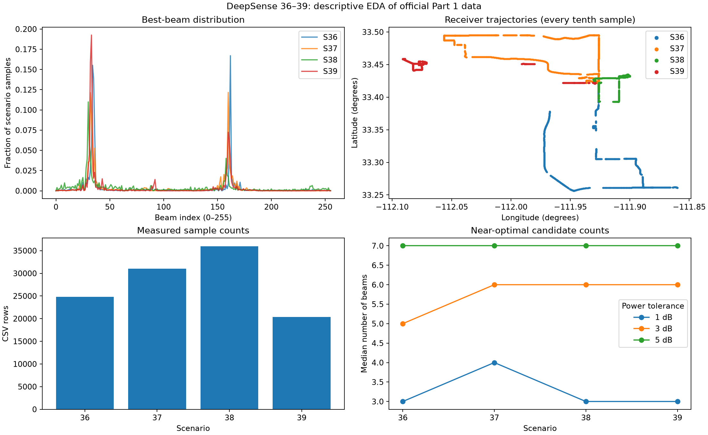

# DeepSense 36–39: data integrity, EDA and training readiness

Generated UTC: 2026-11-08T06:29:15.134379+00:00

## Integrity status

Full audit passed: **True**. Files scanned: **892,474**. File errors: **0**.

Checks: CSV-reference existence, nonempty files, extracted-file counts, full JPEG decoding, GPS/PWR text parsing, numeric agreement with source metadata, CSV/pickle alignment, and local content fingerprints.

Local hashes are not publisher-provided checksums. These checks cannot establish that the original data collection was lossless; they test the acquired Part 1 files and their consistency with supplied metadata.

## Descriptive EDA

- S36: 24,799 CSV rows, 124 sequence IDs, 19 trajectory blocks under the 25-index-gap rule, 238/256 observed best-beam classes; median Tx–Rx separation 37.7 m.
- S37: 30,999 CSV rows, 155 sequence IDs, 19 trajectory blocks under the 25-index-gap rule, 201/256 observed best-beam classes; median Tx–Rx separation 28.0 m.
- S38: 35,999 CSV rows, 180 sequence IDs, 23 trajectory blocks under the 25-index-gap rule, 252/256 observed best-beam classes; median Tx–Rx separation 23.3 m.
- S39: 20,399 CSV rows, 102 sequence IDs, 15 trajectory blocks under the 25-index-gap rule, 221/256 observed best-beam classes; median Tx–Rx separation 21.6 m.

Interpretation and next checks:

- All four metadata checks pass: no duplicate absolute IDs, exact CSV/pickle label agreement, and full-profile argmax matches the label. This is descriptive data validation, not model performance.
- Nine within-sequence intervals are outside 0.08–0.12 seconds (S36: 2, S38: 7). No within-sequence sample-index gaps or nonpositive time differences were found. Keep the observations; record actual future horizons and assess timing sensitivity before final experiments.
- There is one unreferenced raw file per downloaded sensor directory in each scenario (32 files total). They remain on disk. This is a source metadata/raw-file discrepancy, not evidence that our download lost files. Do not invent missing labels or add these files to supervised samples.
- Sequence IDs are not independent trajectories: 124/155/180/102 sequences become 19/19/23/15 blocks under the current grouping rule. Retain trajectory-level separation and uncertainty estimates.
- Best-beam classes are imbalanced; train-derived baselines and per-scenario metrics are required. All-data class proportions in EDA must not become test-tuned baseline choices.

## Training smoke matrix

26 configurations are prepared: B1/B2/B3/B4/P1/P2/P3; resolutions 96/160/224; batch sizes 8/16; FP32/BF16; learning rates 0.00003/0.0001/0.0003; profile-loss weights 0.03/0.1/0.3; dropout 0/0.12/0.25; seeds 42/7/13. This is a controlled feasibility matrix, not a full Cartesian grid or a hyperparameter selection experiment.

Each case uses three optimizer steps on a fixed train-only sample spanning four scenarios. Checks include finite losses/gradients, parameter counts, step time, peak allocated GPU memory and a checkpoint save/restore test for the default P3 case. Out-of-memory cases identify hardware limits. Front RGB5 is used for model compatibility; both RGB5 and RGB6 are checked by the data audit.

Cases recorded: 26/26. Passed: 26; out of memory: 0; failed: 0. Matrix complete: True.

Smoke results are **not** accuracy estimates, publication evidence, or proof of convergence. Official-baseline reproduction, protocol comparison, feedback-cost audit and full multi-seed experiments remain pending.

## Files and resumption

- `eda.json`: numerical descriptors and source metadata hashes.
- `scenarioNN_MODALITY_audit.json`: full-file checks and content fingerprints.
- `integrity_summary.json`: final integrity gate (created only after all 12 modality checks).
- `window_and_split_audit.json`: qualified blocks, splits and actual horizon distributions.
- `training_smoke.json`: case-by-case GPU test evidence.
- `../data_acquisition/readiness_supervisor.json`: watchdog status.

Run `python -m src.supervise_work --job readiness` using the configured Python 3.11 interpreter. Completed audit modalities are checkpointed. This work is local and does not need internet because the ResNet weights are already cached.

## Completed Scenario 36 GPU preflight

Status: **passed**. The full S36 GPS, power and image audits passed before this test.

P3: 17,113,408 total parameters, batch 4, 96-pixel images, BF16, three optimizer steps. Loss values: [127.8860855102539, 126.96415710449219, 126.45112609863281]. Peak allocated PyTorch GPU memory: 0.340 GiB. This small-batch check demonstrates executable training, not generalization or convergence.
